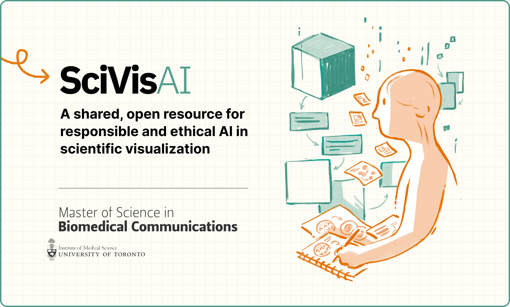

<picture>
	<source media="(max-width: 40rem)" srcset="HomeHeader_Mobile.png">
	
</picture>

**Scientific and medical visualization professionals are navigating a rapidly evolving AI landscape. This resource hub provides field-specific guidance to help practitioners, educators, and students navigate AI responsibly in their practice.**

## Who Is This For

#### Professionals
For practicing medical illustrators and science visualization professionals, this resource offers workflow guidance grounded in real production contexts, case studies, and information to help navigate copyright, attribution, accuracy, and responsible use.

#### Students
If you’re entering the field, this resource provides a grounded, critical understanding of how AI intersects with scientific and medical visualization, exploring both its possibilities and its limitations.

#### Educators
This resource provides information and materials to support the integration of AI topics into your teaching, including discussions around responsible use, professional practice, case studies, and pedagogical resources developed specifically for biomedical communications and scientific illustration programs.

## Why This Matters Now
AI tools are already reshaping scientific and medical visualization workflows. Practitioners are experimenting with generative tools. Publishers are establishing new disclosure requirements. Institutions are developing policies around AI attribution and use. And many of the software tools we use every day now have AI features built into them.

Whether you’re skeptical about AI or enthusiastically experimenting, these developments raise questions that are difficult to navigate in isolation. We need space for open dialogue, critical reflection, and collaboration across our community. SciVisAI is one way to help create that space.

## How Should We Be Thinking About AI in Our Field?

More specifically, what should shape our decisions about whether, when, and how to use AI?

There isn’t one answer. The decisions we make about AI are shaped by many interconnected considerations: the scientific integrity of our work, our responsibilities to audiences and clients, the creative judgment we bring to our practice, the rights and contributions of others, and the broader professional, social, and environmental consequences of these technologies.

### Explore the Landscape

The interactive below maps some of the key considerations shaping AI in scientific and medical visualization. Explore the different areas, follow the connections between them, and consider how these questions might influence your own practice. There are no simple answers or universal rules. The aim is to make the landscape easier to navigate, surface important tensions, and encourage more informed conversations about the choices we make.

<strong>Interactive landscape coming soon</strong> 
An interactive map of the considerations and connections shaping AI in our field will appear here.

*Visualized by [Emily Huang](https://www.emilyhuang.ca/), in collaboration with SciVisAI.*

<strong style="font-family: system-ui, -apple-system, BlinkMacSystemFont, 'Segoe UI', sans-serif;">Explore six areas shaping AI in our field</strong>

Open each topic below to explore the questions it raises about using AI in scientific and medical visualization.

<strong>The Observatory of Truth</strong> Accuracy &amp; Scientific Integrity

AI-generated content can look convincing. Consider how you evaluate accuracy, verify details, distinguish evidence from plausible invention, and decide whether an output is something you can confidently defend.

<strong>The Keeper’s Atelier</strong> Creative Practice &amp; Human Judgment

AI can introduce new creative possibilities, but it can also reshape how we make decisions along the way. Consider what you value about your creative process, where human judgment matters, and what you are willing to delegate.

<strong>The Cave of Confidentiality</strong> Rights, Privacy &amp; Accountability

Using AI raises questions about whose work, information, and permissions are involved. Consider copyright, consent, ownership, confidentiality, and disclosure, as well as who takes responsibility for the decisions and outcomes of AI-assisted work.

<strong>The Guild of Makers</strong> Professional Practice &amp; Expertise

AI is changing how scientific visualization is produced, taught, and valued. Consider how tools reshape workflows, what skills remain essential, how professional roles evolve, and who gets to decide when and how AI is used.

<strong>The Forest of Consequences</strong> Social &amp; Environmental Impact

AI tools have consequences. Consider the energy, water, infrastructure, and resources they require, alongside broader questions of access, economic benefit, and who bears the costs of their development and use.

<strong>The Rapids of Change</strong> The Unknown

AI is evolving faster than our understanding of its implications. Consider what remains uncertain, what questions we have yet to ask, and how we balance the excitement of new possibilities with the need for caution, reflection, and responsible progress.

<strong style="font-family: system-ui, -apple-system, BlinkMacSystemFont, 'Segoe UI', sans-serif;">Downloadable Poster</strong> A downloadable version of the landscape will be available here soon. <button type="button" class="btn" disabled aria-disabled="true" style="margin-top: 0.75rem; cursor: not-allowed; opacity: 0.6;">Download poster (coming soon)</button>

## Beyond Individual Considerations

Thinking about AI requires multidimensionality. Decisions that support one goal can introduce new challenges elsewhere, revealing tensions between efficiency, accuracy, creative control, professional responsibility, and other values.

For example, does making image production faster necessarily make it better? What might be gained in efficiency, and what might be lost in scientific integrity or creative control? A system might expand access to visualization tools while relying on training data created without artists’ consent. Using AI to support student work might introduce new possibilities for experimentation, but what happens to the visual and scientific expertise students need to develop for themselves? These are not simply technical questions. They touch on the values, responsibilities, and professional knowledge that shape scientific and medical visualization.

It is also important to recognize that AI is not a single, uniform technology. Different systems are developed using different datasets, methods, and infrastructures, and have different implications for copyright, labour, privacy, and the environment. The consequences of using AI depend not only on what we do with these tools, but also on how they are built and who benefits from them.

AI technology is developing rapidly, and its longer-term implications remain uncertain. Some questions will evolve as the technology does; others, concerning scientific accuracy, human judgment, authorship, and responsibility, will remain central to our work. We believe there will continue to be an important role for human scientific communicators. How that role evolves, however, is something we have an opportunity to shape together.

SciVisAI is an evolving resource and an ongoing community effort. We invite practitioners, educators, students, and researchers to explore, question, contribute, and help shape the conversation.

## Contributing

This resource hub grows stronger with community participation. We welcome technical experiments and case studies, tool reviews and workflow documentation, teaching materials and pedagogical insights, and feedback on existing content.

## About This Project

This resource hub is led by [Shehryar (Shay) Saharan](mailto:s.saharan@utoronto.ca), [Derek Ng](mailto:d.ng@utoronto.ca), and [Nick Woolridge](mailto:n.woolridge@utoronto.ca) at [Biomedical Communications, University of Toronto](https://bmc.med.utoronto.ca/).

Collaborators: Grace Gibson, Joseph Henein, Emily Huang, Sania Khurshid, Winter Kraemer, Tristy Liu, Sandy Marshall, and Kelsey Zhao.

## Information Hierarchy

- [Foundations](foundations/)
- [Responsible Use](responsible-use/)
- [AI in Practice](ai-in-practice/)
- [Technology Guides](technology-guides/)
- [How to Contribute](how-to-contribute/)

## How to Use This Resource

This site is organized to support different entry points into AI for scientific and medical visualization.

### Suggested Paths

- Start with [Understanding AI](foundations/understanding-ai/) for foundational concepts.
- Visit [Technology Guides](technology-guides/) for practical setup and workflows.
- Review [Responsible Use](responsible-use/) before production use.
